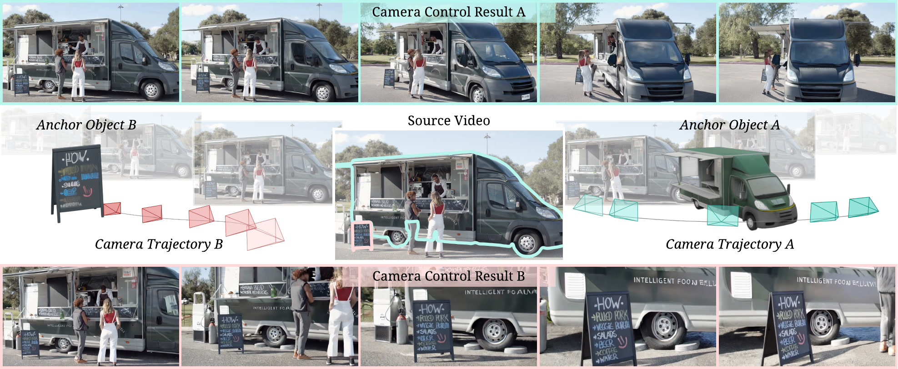

# AnyCam: Anything Can Represent Camera for Video Generation

[Weijie Lyu](https://weijielyu.github.io/)<sup>1</sup>, [Zhixin Shu](https://zhixinshu.github.io/)<sup>2</sup>, Yuntian Ke<sup>3</sup>, [Ming-Hsuan Yang](https://faculty.ucmerced.edu/mhyang/)<sup>1</sup>  
<sup>1</sup>University of California, Merced &nbsp; <sup>2</sup>Adobe Research &nbsp; <sup>3</sup>University of Pennsylvania

[](https://weijielyu.github.io/AnyCam) [](https://youtu.be/YF6fqQmesy0)
<!-- [](https://arxiv.org/abs/XXXX.XXXXX) -->

<div align='center'>

</div>

> **AnyCam** represents the camera with the rendering of any object in the scene, a camera condition that is scale-aware, view-complete and object-relative, which enables object-centric camera control.

## 🚀 Code

Code coming soon.

## 📝 Citation

If you find our work useful for your project, please consider citing our paper.

```bibtex
@article{lyu2026anycam,
  title   = {AnyCam: Anything Can Represent Camera for Video Generation},
  author  = {Lyu, Weijie and Shu, Zhixin and Ke, Yuntian and Yang, Ming-Hsuan},
  year    = {2026}
}
```
